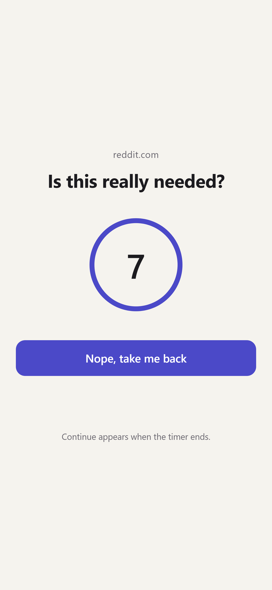
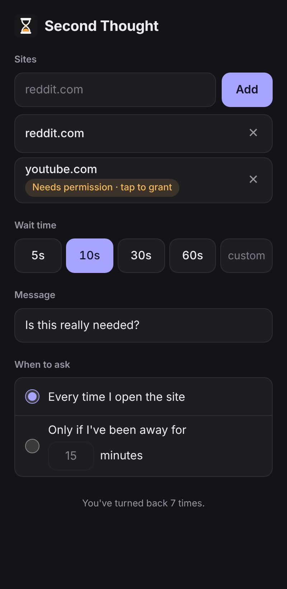

# Second Thought

A Firefox add-on that makes you pause before opening distracting sites.

Open a site from your list and a calm, full-screen pause screen covers it. It shows your message (*"Is this really needed?"*) and a short countdown. **Nope, take me back** works right away. **Continue** only appears once the countdown ends, and the countdown only runs while you're actually looking at the tab.

Works on **Firefox for desktop** (140+) and **Firefox for Android** (142+). No accounts, no tracking, nothing leaves your browser, and no permission warnings at install.

<p>
  
  &nbsp;
  
</p>

## Using it

Tap the toolbar button (on Android: **⋮ menu → Extensions → Second Thought**). That's the whole settings page, and changes save as you make them:

| Setting | What it does |
|---|---|
| **Sites** | Type `reddit.com` (or paste any URL) and tap **Add**. Firefox asks for permission for that one site. A site also covers its subdomains (`old.reddit.com`, `m.reddit.com`). Tap ✕ to remove a site. |
| **Wait time** | 5 / 10 / 30 / 60 seconds, or tap **Custom** and type any number. |
| **Message** | Pick one of five messages, or choose **Write my own…** and type yours. |
| **When to ask** | *Every time I open the site*: once you continue, that tab stays unlocked until it leaves the site. *Only if I've been away for N minutes*: no pause if you were on the site recently. |
| **Also ask after Firefox restarts** | On (default): a tab Firefox reopens on a listed site asks again. Off: tabs that were already open when Firefox started go straight through. |
| **Also ask when I switch back** | Off (default). On: coming back to a site's tab (from another tab or app, or after locking the phone) asks again. In *away* mode it only asks if you were gone longer than your minutes. "Nope" on this pause closes the tab. |
| **Theme** | *Auto* follows your system's light/dark setting. *Light* or *Dark* forces one for both the settings page and the pause screen. |

## Project layout

```
manifest.json          MV3 manifest (Firefox desktop + Android)
background.js          content-script registration, visit logic, counter
content/pause.js       the pause screen: overlay, countdown, media pausing
options/options.*      settings page, also the toolbar popup
icons/                 add-on icons (icon.svg is the source)
store/                 screenshots for the AMO listing (not packaged)
.github/workflows/     build on every push; release on version tags
```

Plain JS/HTML/CSS. No build step, no dependencies. The only tool is [`web-ext`](https://github.com/mozilla/web-ext), which runs through `npx`.

### How it works (short version)

- **Permissions:** only `storage` and `scripting`. Site access is requested one site at a time when you add it (`*://*.site/*`), and given back when you remove it. The background script registers `content/pause.js` for each granted site at `document_start`, and re-syncs on startup, on install, and whenever the site list or permissions change. There's no `tabs` permission: Firefox only shows the add-on the addresses of tabs on your listed sites, so a tab whose address is hidden has left them.
- **Pause screen:** at `document_start` the script hides `<html>` with inline `!important` styles, so neither CSP nor site CSS can undo them. It pauses and mutes every `<video>`/`<audio>`, including ones inside shadow roots, then asks the background script whether this visit needs a pause. The overlay lives in a closed shadow root and is built without `innerHTML`.
- **Visits:** in *every time* mode, Continue sets a per-tab pass (`allow:<tabId>` in `storage.session`), cleared when the tab leaves the site or closes. In *away* mode, `active:<site>` in `storage.local` is refreshed every 30 s and on visibility changes while a visible tab is on the site. Coming back with Back/Forward counts as a new visit.
- **Restarting Firefox:** `storage.session` is cleared when Firefox quits, so reopened tabs ask again by default. At the start of each session the background notes which tabs are already open on a listed site (`restored:<tabId>`). With *Also ask after Firefox restarts* off, that lets their first load through.
- **Switching back:** with *Also ask when I switch back* on, the page is hidden as soon as the tab is hidden, and checked again (`reason: "return"`) when it's visible.
- **Private windows:** nothing from a private tab is written to `storage.local`. Private tabs only get their in-memory pass in `storage.session`.

## Develop and test

Requires a current Node.js LTS.

```sh
npx web-ext lint                 # must report 0 errors / 0 warnings / 0 notices
npx web-ext run                  # launches a temporary Firefox profile with the add-on
npx web-ext build                # makes web-ext-artifacts/second_thought-<version>.zip
```

### On an Android phone (USB)

1. On the phone, turn on **Developer options → USB debugging**. In Firefox for Android, turn on **Settings → Remote debugging via USB**.
2. Connect the phone, then on the computer:
   ```sh
   adb devices                                   # note the device id
   npx web-ext run -t firefox-android --android-device <id>
   # if several Firefox builds are installed, choose one:
   #   --firefox-apk org.mozilla.firefox  (or org.mozilla.fenix for Nightly)
   ```
   Firefox starts on the phone with the add-on loaded temporarily. It goes away when you stop `web-ext`.

### Manual checklist

1. Add `reddit.com` → permission prompt → open reddit.com → pause screen appears, the page isn't visible, Continue isn't shown.
2. Switch to another tab mid-countdown, wait, come back → the number didn't move.
3. Countdown ends → Continue fades in → tap it → page and any video/audio come back. Browsing within Reddit, or reloading, doesn't prompt again. A **new** tab on Reddit does.
4. In that same tab, go to another site, then come back to Reddit → it prompts again.
5. Click a Reddit link from another site → **Nope** → you're back on that site. Open Reddit in a fresh tab → **Nope** → the tab closes. The counter in settings goes up.
6. Switch to *away* mode with 1 minute. Leave Reddit for over a minute and come back → it prompts. Come back sooner → it doesn't.
7. `old.reddit.com` is covered. Remove `reddit.com` → no more prompts.
8. With Reddit open in a tab (in *every time* mode), quit Firefox and start it again → the reopened tab asks again. Turn off *Also ask after Firefox restarts* and repeat → it doesn't.
9. Turn on *Also ask when I switch back*. Continue into Reddit, switch to another tab, then come back → the pause shows again. "Nope" closes the tab.
10. Switch **Theme** between Auto, Light and Dark → the settings page and the next pause screen follow it.

## Releasing

Every Firefox add-on has to be signed by Mozilla. Second Thought is **listed** on addons.mozilla.org (AMO), so anyone can install it on desktop and Android, and updates reach users automatically.

### Release a new version

Releases are automated by GitHub Actions:

```sh
# 1. bump "version" in manifest.json (e.g. 1.0.3) and commit it
git commit -am "Release 1.0.3"
git push origin main
# 2. tag that commit with the same version and push the tag
git tag v1.0.3
git push origin v1.0.3
```

The **Release** workflow (`.github/workflows/release.yml`) then:

1. checks the tag matches `"version"` in `manifest.json`,
2. lints and builds,
3. creates a GitHub Release with the zip,
4. submits the version to AMO for review (when the AMO secrets are set).

Mozilla emails you when the update is approved. Every upload needs a higher version number than any before it, even a failed one. The **Build** workflow (`ci.yml`) runs on every push and pull request; its zip is under **Artifacts** on the run's page in the **Actions** tab.

**One-time setup** (already done for this repo): generate API keys in the AMO Developer Hub under **Tools → Manage API Keys**, then add them in GitHub under **Settings → Secrets and variables → Actions** as `AMO_JWT_ISSUER` (the "JWT issuer") and `AMO_JWT_SECRET` (the "JWT secret"). Without them, releases still build and create the GitHub Release; upload its zip in the Developer Hub by hand.

### Store listing

Reference for the listing on AMO (Developer Hub → your add-on → **Edit Product Page**):

- **Name:** Second Thought
- **Summary:** *A gentle pause before opening the sites that eat your time. Add a site, and Firefox asks "Is this really needed?" with a short countdown before letting you in.*
- **Category:** the closest one on offer (e.g. *Other*).
- **License:** MIT
- **Privacy policy:** not needed. The add-on collects and sends nothing, and the manifest declares `data_collection_permissions: none`.
- **Support:** the GitHub repo's Issues page.
- **Screenshots** (in `store/`): phone shots at Galaxy S25 Ultra size (1440×3120) of the pause screen and settings, in light and dark (`*-phone-light.png`, `*-phone-dark.png`), plus desktop pause screens at 1280×800 (`pause-desktop-*.png`).
- **Icon:** taken from `icons/icon-128.png` automatically.
- **Source code question** ("Do you use code generators, minifiers, bundlers…?"): **No**.

**Description:**

> Second Thought is an app lock for distracting websites.
>
> Add the sites you want to think twice about. When you open one, a calm full-screen pause covers the page and asks "Is this really needed?" while a short countdown runs.
>
> • "Nope, take me back" is always one tap away.
> • "Continue" only appears once the countdown ends, and the countdown only runs while you're looking at the tab.
> • The page stays hidden and any video or audio stays paused until you continue.
> • Choose to be asked every time, or only after you've been away for a while.
> • Optionally ask again when you switch back to the tab, or after Firefox restarts.
> • Pick one of five messages, or write your own.
> • Light, dark, or follow your system.
>
> The settings fit on one screen: your sites, the wait time, your message, when to ask, and the theme. No accounts, no tracking, no sync, and nothing leaves your browser. There are no permission warnings at install: Firefox only asks for access to the sites you add, and nothing is saved from private windows.
>
> Works on Firefox for desktop and Android.

**Notes to reviewer:**

> No build step, no remote code, no third-party libraries; all files are hand-written and unminified. Permissions: only `storage` (settings) and `scripting` (registers the content script only for sites the user adds); no `tabs` permission. Tab URLs are only visible for sites the user granted, which is all the add-on needs: a tab whose URL is hidden has left the user's sites. Host access is requested per site at runtime via `optional_host_permissions`; nothing is requested at install. No data leaves the browser (`data_collection_permissions: none`). Settings and a per-site "last active" time are kept in `storage.local`; nothing from private windows is written there (private tabs only get an in-memory per-tab pass in `storage.session`). The pause screen is user-configured and only closes a tab or goes back when the user taps "Nope".
>
> To test: open the toolbar popup, add `example.com`, allow the permission, then open https://example.com. A pause screen appears; "Continue" shows after 10 seconds. No account or credentials needed.

### Signing a private copy

To use a build before it's approved, sign an **unlisted** copy. That's signed automatically in a few minutes, with no human review. Give it a version above the last release but below the next one (e.g. `1.0.2.1`), and don't commit that version change:

```sh
npx web-ext sign --channel=unlisted --api-key=$AMO_JWT_ISSUER --api-secret=$AMO_JWT_SECRET
```

The signed `.xpi` is saved in `web-ext-artifacts/`. Install it:

- **Firefox desktop:** `about:addons` → ⚙ → **Install Add-on From File…** and pick the `.xpi`, or drag it onto a Firefox window.
- **Firefox for Android:** copy the `.xpi` to the phone. In Firefox, go to **Settings → About Firefox** and tap the Firefox logo 5 times to unlock the hidden menu. Then go back to **Settings**, tap **Install extension from file**, and pick the `.xpi`. Some users report the option missing on Android versions below 10.

It uses the same add-on ID as the store version, so installing the store version later replaces it and keeps your settings. Signed add-ons keep working permanently; temporary installs from `web-ext run` don't.

## License

MIT
