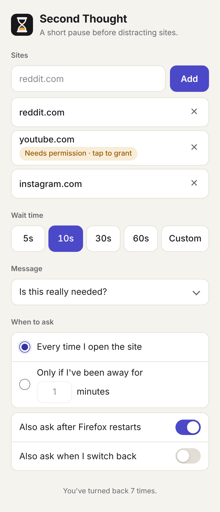

# Second Thought

A Firefox add-on that makes you pause before opening distracting sites.

Open a site from your list and a calm, full-screen pause screen covers it. It shows your message (*"Is this really needed?"*) and a short countdown. **Nope, take me back** works right away. **Continue** only appears once the countdown ends, and the countdown only runs while you're actually looking at the tab.

Works on **Firefox desktop** and **Firefox for Android** (140+ / 142+).

<p>
  
  
</p>

## Using it

Tap the toolbar button (on Android: **⋮ menu → Extensions → Second Thought**). That's the whole settings page:

| Setting | What it does |
|---|---|
| **Sites** | Type `reddit.com` (or paste any URL) and tap **Add**. Firefox asks for permission for that one site. A site also covers its subdomains (`old.reddit.com`, `m.reddit.com`). Tap ✕ to remove a site. |
| **Wait time** | 5 / 10 / 30 / 60 seconds, or tap **Custom** and type any number. |
| **Message** | Pick one of five messages, or choose **Write my own…** and type yours. |
| **When to ask** | *Every time I open the site*: once you continue, that tab stays unlocked until it leaves the site. *Only if I've been away for N minutes*: no pause if you were on the site recently. |
| **Also ask after Firefox restarts** | On (default): a tab Firefox reopens on a listed site asks again. Off: tabs that were already open when Firefox started go straight through. |
| **Also ask when I switch back** | Off (default). On: coming back to a site's tab (from another tab or app, or after locking the phone) asks again. In *away* mode it only asks if you were gone longer than your minutes. "Nope" on this pause closes the tab. |

Changes save as you make them.

## Project layout

```
manifest.json          MV3 manifest (Firefox desktop + Android)
background.js          content-script registration, visit logic, counter
content/pause.js       the pause screen: overlay, countdown, media pausing
options/options.*      settings page, also the toolbar popup
icons/                 add-on icons
store/                 screenshots for the AMO listing (not packaged)
```

Plain JS/HTML/CSS. No build step, no dependencies. The only tool is [`web-ext`](https://github.com/mozilla/web-ext), which runs through `npx`.

### How it works (short version)

- **Permissions:** `storage`, `scripting` and `tabs`. There are no host permissions at install. When you add a site, the settings page asks for `*://*.site/*` only. The background script then registers `content/pause.js` for that pattern at `document_start`. It re-syncs registrations on startup, on install, and whenever the site list or granted permissions change. Removing a site unregisters the script and gives the permission back.
- **Pause screen:** at `document_start` the script hides `<html>` with inline `!important` styles, so neither CSP nor site CSS can undo them. It pauses and mutes every `<video>`/`<audio>`, including ones inside shadow roots, then asks the background script whether this visit needs a pause. The overlay lives in a closed shadow root. Continue and Nope restore or leave the page.
- **Visits:** in *every time* mode, a per-tab pass (`allow:<tabId>` in `storage.session`) is set on Continue. It's cleared when the tab goes to another site or closes. In *away* mode, `active:<site>` in `storage.local` is refreshed every 30 s and on visibility changes while a visible tab is on the site.
- **Back/Forward:** returning to a page from the back/forward cache counts as a new visit, so it's checked again.
- **Restarting Firefox:** passes live in `storage.session`, which Firefox clears when it quits, so a reopened tab asks again by default. The first time the background runs in a session, it notes which tabs are already open on a listed site (`restored:<tabId>`). With *Also ask after Firefox restarts* off, that mark lets the tab's first load through.
- **Switching back:** with *Also ask when I switch back* on, the content script hides the page as soon as the tab becomes hidden. When the tab is visible again, it asks the background (`reason: "return"`) and either shows the pause or reveals the page.

## Develop and test

Requires Node.js 18+.

```sh
npx web-ext lint                 # must report 0 errors / 0 warnings / 0 notices
npx web-ext run                  # launches a temporary Firefox profile with the add-on
npx web-ext build                # makes web-ext-artifacts/second_thought-<version>.zip
```

### On an Android phone (USB)

1. On the phone, turn on **Developer options → USB debugging**. In Firefox for Android, turn on **Settings → Remote debugging via USB**.
2. Connect the phone, then on the computer:
   ```sh
   adb devices                                   # note the device id
   npx web-ext run -t firefox-android --android-device <id>
   # if several Firefox builds are installed, choose one:
   #   --firefox-apk org.mozilla.firefox  (or org.mozilla.fenix for Nightly)
   ```
   Firefox starts on the phone with the add-on loaded temporarily. It goes away when you stop `web-ext`.

### Manual checklist

1. Add `reddit.com` → permission prompt → open reddit.com → pause screen appears, the page isn't visible, Continue isn't shown.
2. Switch to another tab mid-countdown, wait, come back → the number didn't move.
3. Countdown ends → Continue fades in → tap it → page and any video/audio come back. Browsing within Reddit, or reloading, doesn't prompt again. A **new** tab on Reddit does.
4. Click a Reddit link from another site → **Nope** → you're back on that site. Open Reddit in a fresh tab → **Nope** → the tab closes. The counter in settings goes up.
5. Switch to *away* mode with 1 minute. Leave Reddit for over a minute and come back → it prompts. Come back sooner → it doesn't.
6. `old.reddit.com` is covered. Remove `reddit.com` → no more prompts.
7. With Reddit open in a tab (in *every time* mode), quit Firefox and start it again → the reopened Reddit tab asks again. Turn off *Also ask after Firefox restarts* and repeat → it doesn't.
8. Turn on *Also ask when I switch back*. Continue into Reddit, switch to another tab, then come back → the pause shows again. "Nope" closes the tab.

## Publish on addons.mozilla.org (AMO)

Every Firefox add-on has to be signed by Mozilla. You can publish it in one of two ways:

- **Listed** (public): it gets a page on addons.mozilla.org. Anyone can install it on desktop and Android with one tap, and updates are automatic.
- **Unlisted**: Mozilla signs it and gives you an `.xpi` that only you distribute.

### Public listing

1. **Account:** sign in at [addons.mozilla.org](https://addons.mozilla.org) and open the [Developer Hub](https://addons.mozilla.org/developers/).
2. **Package:** run `npx web-ext lint` (it must be clean), then `npx web-ext build`. Upload `web-ext-artifacts/second_thought-1.0.0.zip`.
3. **Submit:** Developer Hub → **Submit a New Add-on** → **On this site**. Upload the zip and tick both **Firefox** and **Firefox for Android** as compatible platforms. When asked about source code, answer **No**: nothing is minified or generated, so reviewers read the files as they are.
4. **Listing details** (ready to paste below):
   - **Name:** Second Thought
   - **Summary:** *A gentle pause before opening the sites that eat your time. Add a site, and Firefox asks "Is this really needed?" with a short countdown before letting you in.*
   - **Category:** pick the closest one on offer (e.g. *Other*).
   - **License:** MIT
   - **Privacy policy:** not needed. The add-on collects and sends nothing, and the manifest declares `data_collection_permissions: none`.
   - **Support:** your GitHub repo's Issues page.
   - **Screenshots:** the files in `store/` (`pause-desktop-*.png` are 1280×800, AMO's preferred size).
   - **Icon:** taken from `icons/icon-128.png` automatically.
5. **Notes to reviewer** (paste this, it makes review faster):
   > No build step and no remote code; all files are hand-written and unminified. Permissions: `storage` (settings), `scripting` (register the content script only for sites the user adds), `tabs` (see a tab's URL change so a per-tab "continued" pass is cleared when the tab leaves the site, and close the tab when the user taps "Nope" in a fresh tab). Host access is requested per site at runtime via `optional_host_permissions`; nothing is requested at install. No data leaves the browser.
6. **Review:** automatic validation finishes in seconds. A human review may follow, which can take anywhere from hours to a couple of weeks. You'll get an email either way. Once approved, the add-on is live for desktop and Android.

**Description** (for the listing's longer field):

> Second Thought is an app lock for distracting websites.
>
> Add the sites you want to think twice about. When you open one, a calm full-screen pause covers the page and asks "Is this really needed?" while a short countdown runs.
>
> • "Nope, take me back" is always one tap away.
> • "Continue" only appears once the countdown ends, and the countdown only runs while you're looking at the tab.
> • The page stays hidden and any video or audio stays paused until you continue.
> • Choose to be asked every time, or only after you've been away for a while.
>
> The settings fit on one screen: your sites, the wait time, your message, and when to ask. No accounts, no tracking, no sync. Firefox only asks for access to the sites you add.
>
> Works on Firefox for desktop and Android.

**Updates:** increase `"version"` in `manifest.json` (e.g. `1.0.1`), then either upload a new zip in the Developer Hub or sign from the command line:

```sh
npx web-ext sign --channel=listed --api-key=$AMO_JWT_ISSUER --api-secret=$AMO_JWT_SECRET
```

Get API keys from **Developer Hub → Tools → Manage API Keys**. Keep them out of git.

### Unlisted (sign it just for yourself)

```sh
npx web-ext sign --channel=unlisted --api-key=$AMO_JWT_ISSUER --api-secret=$AMO_JWT_SECRET
```

After automated validation (usually a minute or two), the signed `.xpi` is saved in `web-ext-artifacts/`. Install it:

- **Firefox desktop:** `about:addons` → ⚙ → **Install Add-on From File…** and pick the `.xpi`, or drag it onto a Firefox window.
- **Firefox for Android (release):** copy the `.xpi` to the phone. In Firefox, go to **Settings → About Firefox** and tap the Firefox logo 5 times to unlock the hidden menu. Then go back to **Settings** and tap **Install extension from file**, and pick the `.xpi`. It has to be signed (release Firefox refuses unsigned files). Some users report the option missing on Android versions below 10. If it isn't there for you, use the public AMO listing instead.

Signed add-ons, listed or unlisted, keep working permanently. Temporary installs from `web-ext run` don't.

## License

MIT
